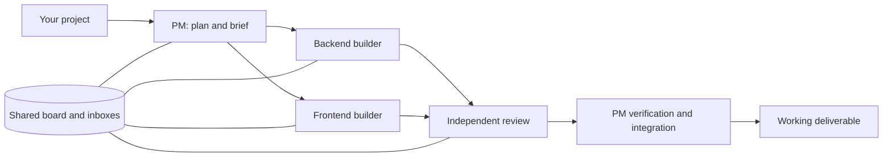

<p align="center"></p>
<h1 align="center">Agent Team PM</h1>
<p align="center"><strong>One project manager. A team of coding agents. Work that keeps moving.</strong></p>
<p align="center">Plan the work, assign clear owners, coordinate across providers and review before shipping.</p>
<p align="center">
  <a href="https://www.npmjs.com/package/agent-team-pm"></a>
  <a href="LICENSE"></a>
  <a href="#quick-start"></a>
  <a href="#homebrew"></a>
</p>
<p align="center"><a href="#quick-start">Quick start</a> · <a href="#how-it-works">How it works</a> · <a href="#daily-use">Daily use</a> · <a href="#faq">FAQ</a> · <a href="https://github.com/alexdeg92/agent-team-pm-releases/releases">Releases</a></p>


*Captured output from the included CLI using synthetic demo data. No live agents, private projects or personal information are shown.*

## A team with a shared plan

Agent Team PM is a **Claude Code skill** for coordinating coding agents in [herdr](https://herdr.dev).
Give the PM a project: it discovers the available tools, plans phases, writes briefs and
assigns each task to a role-named agent in its own pane and worktree.

Agents share a task board and durable inboxes. The PM watches for reports, resolves blockers,
checks the work and coordinates integration. You stay in one conversation with the PM.

| Capability | What it does for your project |
| --- | --- |
| **Several providers** | Allocate work across available, authenticated CLIs and check plan headroom before staffing. |
| **Clear ownership** | Give each builder explicit files, a task brief and an isolated worktree. |
| **Independent review** | Require named reviewer verdicts before a task can be marked done. |
| **Durable coordination** | Keep assignments, dependencies, reports and messages in a shared local board. |
| **Recovery** | Use handoffs and session records when an agent stops, a provider runs out of capacity or the machine restarts. |
| **Optional GitHub mirror** | Mirror board tasks into issues and review branches into pull requests when enabled. |

## Quick start

Requires **Node.js 18+ and npm**. Install the command, then copy the skill into your home directory:

```sh
npm i -g agent-team-pm
agent-team-pm install
agent-team-pm doctor
```

Prefer a one-time command:

```sh
npx agent-team-pm install
npx agent-team-pm doctor
```

Add the shared board command to your shell PATH if it is not already there:

```sh
export PATH="$HOME/.local/bin:$PATH"
```

Start Claude Code inside a herdr pane at the root of your project, then ask:

> Act as PM for this project. Discover the available agents, plan the work in phases,
> assign clear owners across providers, and coordinate implementation and independent review.

The PM creates a project workspace, writes the briefs and starts the team. Read the
[skill workflow](SKILL.md) for the full procedure.

<a id="homebrew"></a>
<details>
<summary><strong>Homebrew · macOS</strong></summary>

```sh
brew tap alexdeg92/tap
brew install alexdeg92/tap/agent-team-pm
agent-team-pm install
agent-team-pm doctor
```

Homebrew installs the installer command. Run `agent-team-pm install` to install the skill
for your own user. It also installs the formula's jq, Node and Python dependencies.
Install herdr and authenticate the coding-agent CLIs separately.
</details>

<details>
<summary><strong>curl · versioned package with checksum verification</strong></summary>

```sh
curl -fsSL https://raw.githubusercontent.com/alexdeg92/agent-team-pm-releases/v0.1.1/install.sh -o /tmp/agent-team-pm-install.sh
bash /tmp/agent-team-pm-install.sh install
```

Requires Node.js 18+, curl, tar and shasum or sha256sum. The script downloads the
versioned GitHub release tarball, verifies its SHA256 and runs the same installer.
</details>

<details>
<summary><strong>Tagged GitHub installation</strong></summary>

```sh
npx github:alexdeg92/agent-team-pm-releases#v0.1.1 install
```

Release assets also include an npm tarball and its SHA256 file.
</details>

## Before starting the team

| Requirement | Purpose |
| --- | --- |
| **herdr** | Runs the PM and agents in panes, with workspace grouping and session tracking. |
| **Claude Code** | Hosts this skill and the PM conversation. |
| **Another authenticated agent CLI** | Supplies builders and independent reviewers; the launch helper supports Claude Code, Codex and Cursor. |
| **git, Python 3, jq, bash, perl, rsync** | Worktrees, the task board, shell helpers and snapshots. |

Discovery can inventory additional CLIs; launching them may require adapting the helper
with the flags reported by their own help. The skill does not sign into providers for you.
`doctor` checks local prerequisites and installed files; it does not start or authenticate agents.

For session restoration after a restart, install the integrations you use:

```sh
herdr integration install claude
herdr integration install codex
herdr integration install cursor
```

Restart each running agent once after adding its integration so herdr records its session.

## How it works



1. **Discover.** Check installed CLIs, authentication, capabilities and provider headroom.
2. **Plan.** Split the project into phases and independent portions with acceptance checks.
3. **Brief.** Record file ownership, shared contracts, verification and reporting instructions.
4. **Build.** Start role-named agents in their own panes and worktrees.
5. **Review.** Gather reports and independent verdicts; resolve blockers and failed checks.
6. **Integrate.** Verify the intended tree, merge when authorized and report the result.

The skill supplies the workflow and helpers. The PM agent makes the project decisions
and carries out the steps; results depend on the agents, models and project checks you use.

## Daily use

The PM and teammates can inspect the same board from any worktree of the repository:

```sh
team board
team task list --mine
team inbox
team member list
```

A small task with a reviewer:

```sh
team task add "Implement the API contract" --owner backend --needs-review reviewer
team task set T-0001 working
team task set T-0001 review --commit "$(git rev-parse HEAD)" --report docs/reports/api.md
team task review T-0001 reviewer go "Contract checks pass"
team task set T-0001 done
```

Use the task id printed by `task add`; `T-0001` above assumes a new board. Submit the exact
commit SHA when using the GitHub mirror. The `done` transition requires every named reviewer
to say go; the PM can explicitly force a transition when appropriate.

The board lives under the repository's shared git directory, so worktrees share it.
Set `TEAM_DIR` for a different location and `TEAM_AGENT` for your board identity.
Messages are durable local records; herdr notifications prompt agents to read their inboxes.

## What gets installed

| Location | Contents |
| --- | --- |
| `~/.claude/skills/agent-team-pm` | Skill instructions, scripts, references and brief templates. |
| `~/.local/bin/team` | A link to the installed shared-board command. |
| npm or Homebrew command directory | The `agent-team-pm` installer command. |

Use `agent-team-pm install --dir <skills dir>` for another skills directory.
The installer detects changed or added files and prints a diff summary before refusing
to replace a modified copy. Review those changes before using `install --force`.

## Works with Agent Office

The member registry records stable member ids and spawner lineage. Dashboards such as
[Agent Office](https://github.com/alexdeg92/agent-office-oss) can read those records and
join them with herdr presence. A dashboard is optional; the PM, board and reports work
from the terminal. See [the member and lineage contract](SKILL.md#team-members-and-lineage-for-dashboards).

## FAQ

**Does this include subscriptions or provider credentials?** No. Install and authenticate
your coding-agent CLIs separately. Provider usage and charges follow those accounts.

**What permissions do agents get?** The launch helper uses each CLI's no-approval flags.
Use it in repositories where those agents are authorized to edit files and run commands.
Production changes and publication still need the authorization described in the project brief.

**Does token auditing work on macOS?** The board and launch/watch helpers support macOS.
`agent-usage.py` currently requires Linux `/proc`; on macOS it reports that limitation.
Use provider dashboards or CLI usage to check headroom there.

**How do I update?** Run `npm i -g agent-team-pm`, then `agent-team-pm install`.
For Homebrew, run `brew update`, `brew upgrade agent-team-pm`, then `agent-team-pm install`.
Local edits remain protected.

**How do I remove it?** Run `agent-team-pm uninstall` to remove the skill and its owned
`team` link. Then run `npm uninstall -g agent-team-pm` or `brew uninstall agent-team-pm`
to remove the installer command. For a one-time install, use `npx agent-team-pm uninstall`.

## Documentation

- [Skill workflow](SKILL.md): staffing, briefs, verification, handoffs and recovery.
- [Agent profiles](references/agent-profiles.md): allocation and calibration.
- [Failure handling](references/failure-modes.md): provider stops, stalls and integration failures.
- [Templates](templates/): shared brief, task brief and reviewer charters.
- [Releases](https://github.com/alexdeg92/agent-team-pm-releases/releases): versioned packages and checksums.

MIT licensed. This repository contains released skill files, documentation and installation tools.
